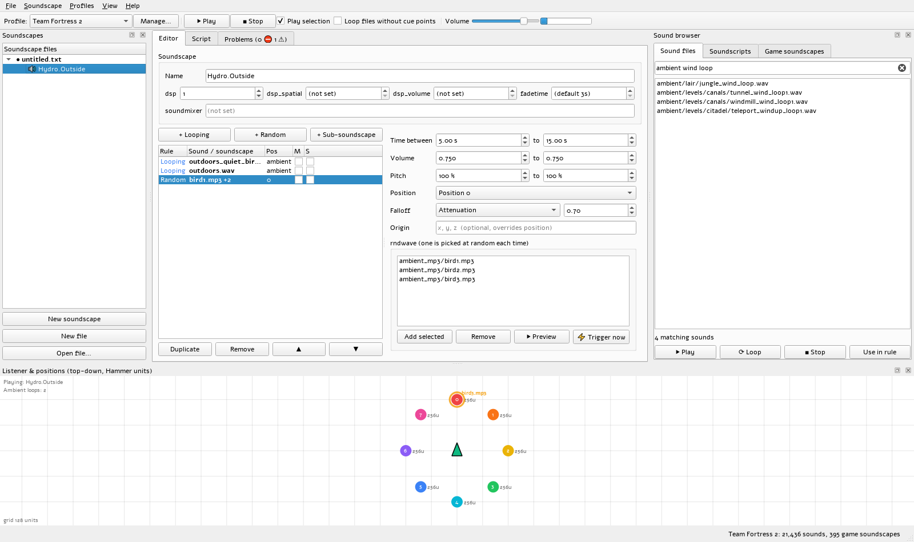

# Source Engine Soundscape Previewer

A desktop tool for level designers to **listen to Source engine soundscapes
without launching the game**. Edit a soundscape and hear the change right away.

It is built for Team Fortress 2 mapping and works with any Source game whose
assets are stored in VPK files (HL2, CS:S, Portal, Garry's Mod, mods...).



## Why

Normally, testing a soundscape means saving the script, launching the game,
loading the map and walking into the `env_soundscape`. You repeat that for
every volume or pitch tweak. This tool reads sounds directly from the game's
VPK files and plays the soundscape the way the engine does, so you can tune
it in seconds.

## Features

- **Live preview.** Changes to volumes, pitches, sounds, positions and rules
  are heard right away, without restarting the loops that are already playing.
- **Game profiles.** Create a profile per game (e.g. *Team Fortress 2*) and
  choose which `_dir.vpk` files and loose content folders it uses. A TF2 profile
  is detected and created automatically from your Steam libraries.
- **Sound browser.** Search and preview all sounds in the profile's VPKs
  (single-click or double-click to play). It
  shows duration, sample rate, which VPK each sound comes from, and whether a
  WAV has a cue point (needed to loop in-game).
  - Soundscript entries (`Ambient.Wind`...) and the game's own soundscapes are
    browsable too. You can play stock soundscapes, copy them into your file,
    or use them as sub-soundscapes.
- **Multiple soundscape files.** Open many `soundscapes_*.txt` files at once,
  each with many soundscapes. Create, rename, duplicate and delete soundscapes.
- **Two ways to edit:**
  - a structured editor for `playlooping`, `playrandom` and `playsoundscape`
    rules, with drag & drop from the sound browser and per-rule
    **mute / solo** (silenced rules are greyed out);
  - a script editor with syntax highlighting, applied live as you type.
    Comments in your files are preserved.
- **External editor support.** The file is watched on disk. Save it from
  Notepad++ or VS Code and the preview updates.
- **Positions map.** A top-down view in Hammer units. Drag the listener and
  positions 0–7 to hear distance falloff (`attenuation` / `soundlevel`) and
  stereo panning. Random sounds flash where they play. Turn a position off to
  simulate an unset `env_soundscape` target.
- **Crossfades.** With *Play selection* on, switching soundscapes crossfades
  using `fadetime`, like walking between soundscapes in-game.
- **Problems panel.** Catches mistakes before you compile:
  - missing sound files
  - looping WAVs without a cue point, and MP3 loops
  - `playrandom` without `rndwave`
  - unknown sub-soundscapes
  - names that clash with other soundscapes
  - duplicate loops (only one instance plays in-game)
  - positioned random sounds without attenuation

- **Light and dark themes.** Follow Windows or pick one in View → Theme.

See [CHANGELOG.md](CHANGELOG.md) for what changed in each version.

## Download

Get the latest Windows build from the
[Releases page](https://github.com/Midlou/Source-Engine-Soundscape-Previewer/releases/latest):

1. Download `SoundscapePreviewer-<version>-windows.zip`.
2. Extract it anywhere.
3. Run `SoundscapePreviewer.exe`. No Python needed.

Settings and profiles are stored in `%APPDATA%\SoundscapePreviewer`.

Windows SmartScreen may warn about an unrecognized app because the build is
not code-signed. Click *More info → Run anyway*.

You need a Source game installed, because sounds are read from its VPK files.

## Running from source

Requires Python 3.10+.

```bat
git clone https://github.com/Midlou/Source-Engine-Soundscape-Previewer.git
cd Source-Engine-Soundscape-Previewer
setup.bat
run.bat
```

`setup.bat` creates a virtual environment in `.venv` and installs the
dependencies: PySide6, numpy, sounddevice and soundfile.

Manual setup:

```bat
python -m venv .venv
.venv\Scripts\pip install -r requirements.txt
.venv\Scripts\python main.py
```

When run from source, settings are stored in `data/settings.json`.

## Building the .exe

```bat
build.bat
```

This installs PyInstaller, builds `dist\SoundscapePreviewer\SoundscapePreviewer.exe`
from `SoundscapePreviewer.spec`, and runs the build's self test
(`SoundscapePreviewer.exe --self-test`).

### Automatic builds and releases

[`.github/workflows/build.yml`](.github/workflows/build.yml) runs on every push
to `main`:

1. Builds the .exe on Windows and runs its self test.
2. Uploads the zip as a build artifact. You can find it on the workflow run's
   page in the *Actions* tab.
3. If `__version__` in `soundscape_previewer/__init__.py` has no release yet,
   it publishes a GitHub Release `v<version>` with the zip attached.

To publish a new version, add a `## <version>` section to
[CHANGELOG.md](CHANGELOG.md) (it becomes the release notes), bump
`__version__` and push to `main`.

## Usage

1. **Pick a profile.** On first start a *Team Fortress 2* profile is created
   if TF2 is installed. Otherwise open **Profiles → Manage profiles**, create a
   profile and add the game's `*_dir.vpk` files.
   - For TF2, sounds are in `tf2_sound_misc` / `hl2_sound_misc`.
   - Soundscripts and stock soundscapes are in `tf2_misc` / `hl2_misc`.
   - Add your map's content folder (e.g. `tf/custom/mymap`) under *Loose
     folders* to use custom sounds.
2. **Open or create a soundscape file.** Use **File → New** for a template,
   or **File → Open** for an existing `soundscapes_*.txt`.
3. **Press Play (F5)** and edit. Drag sounds from the browser into rules, move
   positions on the map, or type in the *Script* tab.
4. **Save** as `tf/scripts/soundscapes_<mapname>.txt`, or pack it into your BSP.

### Shortcuts

| Key | Action |
| --- | --- |
| F5 / F6 | Play / stop the selected soundscape |
| Ctrl+N / Ctrl+O / Ctrl+S | New / open / save file |
| Ctrl+Shift+N | New soundscape |
| Ctrl+D / F2 | Duplicate / rename soundscape |

Positions map: drag to move, right-drag to turn the listener, mouse wheel to
zoom, middle-drag to pan, double-click a position to switch it off.

## Engine accuracy

Behaviour follows the [Valve Developer Wiki](https://developer.valvesoftware.com/wiki/Soundscape)
and the engine's soundscape code.

**Simulated**
- `playlooping`, `playrandom` (`time`, `volume`, `pitch` ranges, `rndwave`)
- `playsoundscape` with `volume`, `position` offset, `positionoverride` and
  `ambientpositionoverride`
- positions 0–7, `position random` (36 units from the listener) and `origin`
- `attenuation` / `soundlevel` falloff
- loops from WAV cue points: like the engine, a WAV without one plays once.
  You can override this with *Loop files without cue points*.
- sound characters (`*`, `#`, `)`, ...), soundscript names as waves, and
  `fadetime`

**Not simulated (but edited and saved):** DSP presets (`dsp`, `dsp_spatial`,
`dsp_volume`), `soundmixer`, and occlusion. Distance falloff is a close
approximation of the engine's formula.

## Project structure

```
main.py                         entry point
soundscape_previewer/
  vpk.py                        VPK v1/v2 reader
  keyvalues.py                  KeyValues parser/writer that keeps comments
  soundscape.py                 soundscape model, playback plans, validation
  gamedata.py                   profile content index (sounds, soundscripts, soundscapes)
  audio.py                      decoding, cue points, real-time mixer
  settings.py                   settings, profiles, Steam detection
  selftest.py                   checks used to verify packaged builds
  ui/                           PySide6 interface
SoundscapePreviewer.spec        PyInstaller build definition
.github/workflows/build.yml     CI build and releases
```

Settings are saved in `data/settings.json` when run from source (not
committed), or in `%APPDATA%\SoundscapePreviewer` for the .exe.

## Credits

Created by [Midlou](https://github.com/Midlou).

Developed with the help of [Claude](https://www.anthropic.com/claude)
(Anthropic), an AI assistant that wrote much of the code under Midlou's
direction and review. Commits it contributed to are marked with a
`Co-Authored-By: Claude` trailer.

## License

[MIT](LICENSE) © 2026 Midlou

Dependencies keep their own licenses: PySide6/Qt (LGPL v3), numpy (BSD),
sounddevice (MIT), soundfile (BSD, bundles libsndfile under LGPL). This
project does not include any Valve game content. Sounds are read at runtime
from your own game installation.
